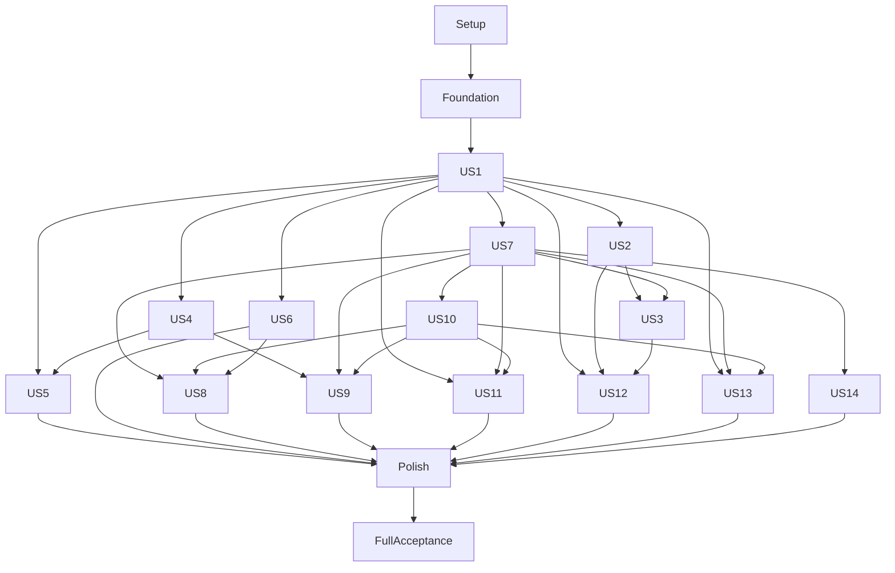

# Tasks: Foundry-v2

**Input**: [plan.md](plan.md), [spec.md](spec.md), [research.md](research.md), [data-model.md](data-model.md), [contracts](contracts/README.md), [quickstart.md](quickstart.md), unchanged constitution v0.2.0.
**Date**: 2026-10-10 | **Branch**: main | **Status**: implementation in progress; completed tasks are checked; live acceptance pending.

Tasks follow the template's Setup → Foundation → prioritized stories → Polish structure. Stories retain their original spec IDs; all P1 phases precede P2/P3 phases. Spec §3.4 and §1.6 explicitly require acceptance testing, so meaningful contract/fault/acceptance tasks are included. Write listed tests before their implementations, establish expected failures, then rerun at the phase checkpoint. Test authoring is distinct from the verification tasks that require them to pass.

All paths are repository-relative implementation targets, including files that do not yet exist. `[US1]` maps to spec `US-1`, etc. `[P]` means independent file sets within that phase's test-authoring wave after prerequisites; it never bypasses phase or implementation dependencies. Within each phase execute unmarked tasks in order. Read each linked design artifact and its referenced requirements before implementing; [task-coverage.md](task-coverage.md) maps every FR/NFR to implementation and verification task IDs.

One role is not an additional process identity: Orchestrator has isolated deterministic and conversational lanes; Validator has separate author/fresh-reproducer sessions. Keep all eight core roles and defer all five extension roles, vector search, other production providers/trackers and compliance mapping. Missing operator deployment inputs block live preflight; do not invent credentials, CIDRs, rates, identity groups or storage support.

## Phase 1: Setup

Initialize package, locked runtime and deterministic fixtures.

### Implementation tasks

- [X] T001 Create CPython 3.12 package, three process entrypoints, CLI/config modules and planned directory layout in pyproject.toml and src/foundry_v2/__init__.py; keep eight role identities distinct. (NFR-003)
- [X] T002 Resolve plan.md pins on Linux Python 3.12 into requirements.lock with hashes, install and smoke-test FastAPI/LangGraph/Ollama/tree-sitter/CVSS; record any necessary compatibility correction in specs/001-foundry/dependency-resolution.json before using it. (NFR-003)
- [X] T003 Build pinned Linux service/worker images and verify scanner archive checksums for OSV-Scanner 2.6.0 and Gitleaks 8.30.1 in deploy/images/Dockerfile and deploy/images/scanners.json; resolve immutable image digests. (NFR-003)
- [X] T004 Create pytest markers and seeded Python/Go, clean, adversarial, scanner and provider/GitHub fixture inventory in tests/conftest.py and tests/fixtures/manifest.json; distinguish live_cluster/live_model tests. (NFR-003)
- [X] T005 Configure deterministic unit/contract/integration CI and explicit opt-in live suites in .github/workflows/validate.yml; never embed credentials or claim skipped checks passed. (NFR-003)

**Checkpoint**: All phase verification tasks pass against stated fixtures; record live prerequisites/unexecuted evidence explicitly.

## Phase 2: Foundation

Blocking shared persistence, identity, liveness and contracts. All stories require this checkpoint.

### Test tasks

- [ ] T006 [P] Write single-owner/start-race, claim-race/late-generation, queue auto-block/stable-ID/reprioritization, CAS/idempotency, role/evaluation isolation and transaction crash tests in tests/integration/test_substrate_foundation.py using data-model.md and runtime.md. (FR-097, FR-098, FR-099, FR-100, FR-103, FR-117, FR-136, FR-138, NFR-007)
- [ ] T007 [P] Write checkpoint pending-write/resume/namespace/unsafe-codec and blob fault tests in tests/contract/test_checkpoint_contract.py against a test-only reference saver. (FR-117, NFR-001, NFR-002)
### Implementation tasks

- [X] T008 Define shared strict DTOs, stable IDs and contract errors from contracts/openapi.json in src/foundry_v2/contracts/models.py; preserve all 41 operation IDs and role identities. (NFR-003)
- [X] T009 Create all data-model.md tables, foreign keys, unique constraints, history, migration versioning and backup-before-migration in src/foundry_v2/substrate/migrations/001_initial.sql and src/foundry_v2/substrate/migrate.py. (FR-087, FR-088, FR-117, FR-138)
- [X] T010 Implement lifetime owner lock, owner epochs, WAL/FULL/foreign keys, serialized short immediate transactions, uncertain-owner refusal and atomic active-evaluation reservation in src/foundry_v2/substrate/owner.py. (FR-117, FR-138)
- [X] T011 Implement actor-scoped idempotency receipt plus mutation transactions, CAS conflicts, cursor lists and safe error responses in src/foundry_v2/substrate/transactions.py. (FR-117, NFR-002, NFR-007)
- [X] T012 Implement immutable SHA-256 staging/fsync/rename, committed visibility, safe orphan handling and backup/restore manifest verification in src/foundry_v2/substrate/blobs.py and src/foundry_v2/substrate/backup.py. (FR-117, NFR-001, NFR-007)
- [X] T013 Implement TokenReview operator allowlist and hashed expiring role/evaluation/session substrate tokens, revocation and separate infrastructure registration authority in src/foundry_v2/api/auth.py and src/foundry_v2/substrate/auth.py. (FR-136, NFR-009)
- [ ] T014 Implement substrate HTTP client and foundation endpoints for session registration, snapshot, blobs and generation reads in src/foundry_v2/substrate/app.py and src/foundry_v2/workers/client.py; fail closed during unknown ownership. (FR-117, FR-136, FR-138, NFR-004)
- [ ] T015 Implement owner checkpoint tuple/pending-write endpoints and controlled typed codec in src/foundry_v2/substrate/checkpoints.py; restrict fresh reproducer access to its own thread. (FR-117, NFR-001)
- [ ] T016 Implement asynchronous BaseCheckpointSaver methods and pinned-version serialization/versioning conformance in src/foundry_v2/checkpoints/http_saver.py; encode empty namespace as _root and preserve parent/pending writes. (NFR-001, NFR-002)
- [ ] T017 Implement append-only sequenced events, redacted transcript chunks, explicit persistence-failure events and complete generation pointer swaps in src/foundry_v2/substrate/audit.py. (FR-117, FR-141, NFR-006, NFR-007)
- [ ] T018 Implement stable-ID named queues, atomic task/finding/file claims, generation fences, CAS writes and configurable release-count auto-block in src/foundry_v2/substrate/claims.py and src/foundry_v2/substrate/tasks.py. (FR-097, FR-098, FR-099, FR-100, FR-101, FR-103)
- [ ] T019 Implement receipt-clock heartbeats, stale-only reaper and restart grace in src/foundry_v2/substrate/liveness.py; neither rotation nor slow calls reclaims healthy claims. (FR-006, FR-099, FR-104)
- [ ] T020 Implement independent heartbeat sender, graph checkpoint handoff, secret-free tool execution boundary and advisory/operator origins in src/foundry_v2/workers/runtime.py and src/foundry_v2/workers/heartbeat.py. (FR-003, FR-104, FR-105, NFR-001, NFR-009)
- [ ] T021 Define injection interfaces for provider/index/substrate/publisher/deployment/clock and a fixed eight-role graph registry in src/foundry_v2/integrations/ports.py and src/foundry_v2/roles/registry.py; use deterministic fakes until each story binding is ready. (FR-013, NFR-003)
### Verification tasks

- [ ] T022 Run foundation fault/race/auth/checkpoint suites and capture failures and recovery assertions in tests/integration/test_substrate_foundation.py; foundation blocks every story until passed. (FR-117, FR-136, FR-138, NFR-001, NFR-007)

**Checkpoint**: All phase verification tasks pass against stated fixtures; record live prerequisites/unexecuted evidence explicitly.

## Phase 3: US-1 — Start an authorized evaluation (P1)

**Goal / independent acceptance**: Fresh checkout and valid fixture config: CLI up starts Indexer first, required scoped queries pass, then remaining seven role types run without a cartography gate; invalid config/capability and concurrent starts fail safely.

**Prerequisites**: Foundation. Adjacent stages can use fixed fixtures for independent acceptance; complete system acceptance requires real bindings.

### Test tasks

- [ ] T023 [P] [US1] Write startup-order, invalid/missing config, cap guard, model capability, race and crash-loop acceptance tests in tests/acceptance/test_us1_start.py with fake adjacent roles. (FR-001, FR-002, FR-003, FR-004, FR-005, FR-006, FR-007, FR-008, FR-010, FR-011, FR-013, FR-134, FR-138, FR-145, FR-146, FR-148, FR-149)
- [ ] T024 [P] [US1] Write scoped Python/Go inventory/static-call/query, parse-skip and atomic-generation fixtures in tests/unit/test_indexing.py including a CPU-bound parse while status responds. (FR-021, FR-022, FR-023, FR-024, FR-025, FR-026, FR-028, FR-029, FR-030)
### Implementation tasks

- [ ] T025 [US1] Implement YAML shape plus runtime semantic validation, all missing-field errors, versioned config and secret references in src/foundry_v2/config.py; reject placeholder revisions/unsafe endpoints and controlled-restart fields. (FR-001, FR-145, FR-146, FR-148, FR-149)
- [ ] T026 [US1] Implement native Ollama tool/system/terminal-token capability probes, model digest and aggregated GitHub/testbed/storage/policy preflight in src/foundry_v2/integrations/preflight.py; binding invokes US6 policy probes when installed. (FR-011, FR-134)
- [ ] T027 [US1] Implement scoped commit-pinned source acquisition and deterministic Python/Go parser inventories/static and resolvable indirect edges in src/foundry_v2/indexing/parser.py and src/foundry_v2/indexing/source.py; mark unresolved calls and visible skipped files. (FR-021, FR-022, FR-023, FR-028, FR-029)
- [ ] T028 [US1] Implement function/body/caller/callee/symbol/text queries, staged complete generation publication and readiness assertions in src/foundry_v2/indexing/service.py and src/foundry_v2/roles/indexer.py; isolate parsing in its worker process. (FR-024, FR-025, FR-026, FR-030)
- [ ] T029 [US1] Implement sole-authority persisted Job reconciliation/adoption, Indexer readiness gate, desired role counts, exponential unlimited-attempt crash retry and graceful drain in src/foundry_v2/orchestrator/lifecycle.py. (FR-002, FR-003, FR-004, FR-005, FR-006, FR-007, FR-008, FR-013)
- [ ] T030 [US1] Implement atomic config revisions and fleet count reconciliation in src/foundry_v2/orchestrator/configuration.py; safely restart changed target/sandbox/integrations and wire rules/budget handlers supplied by later stories. (FR-010, FR-145, FR-147, FR-148)
- [ ] T031 [US1] Implement authenticated start/control/config endpoints and CLI up/preflight/status/stop in src/foundry_v2/api/evaluations.py and src/foundry_v2/cli.py; provide one-command up alias and async preflight/index states. (FR-001, FR-007, FR-138, FR-149)
### Verification tasks

- [ ] T032 [US1] Run US1 fixture startup and parser tests in tests/acceptance/test_us1_start.py; record real-binding startup as pending until US5/US6/US7/US10 and deployment inputs are ready. (FR-004, FR-025, FR-030, FR-134, FR-138)

**Checkpoint**: All phase verification tasks pass against stated fixtures; record live prerequisites/unexecuted evidence explicitly.

## Phase 4: US-2 — Inspect live progress (P1)

**Goal / independent acceptance**: Using synthetic substrate state and delayed provider responses, status/dashboard at the same snapshot ID show every session/claim, counts, coverage, budget and blockers; event reconnect and outages remain visible.

**Prerequisites**: Foundation, US-1. Adjacent stages can use fixed fixtures for independent acceptance; complete system acceptance requires real bindings.

### Test tasks

- [ ] T033 [US2] Write snapshot equality, live feed reconnect/gap, outage, message dedup/ack and redaction acceptance tests in tests/acceptance/test_us2_visibility.py. (FR-009, FR-107, FR-108, FR-109, FR-110, FR-139, FR-140, FR-141, FR-142, FR-143, FR-144, NFR-006, NFR-007)
### Implementation tasks

- [ ] T034 [US2] Implement owner-consistent fleet/finding/coverage/ledger/queue/message snapshot and status in src/foundry_v2/substrate/snapshots.py and src/foundry_v2/api/status.py; no status LLM calls. (FR-009, FR-139, FR-143)
- [ ] T035 [US2] Implement nonblocking typed operator messages, fleet equivalence dedup, acknowledgment/removal and no finding/progress payload policy in src/foundry_v2/substrate/messages.py and src/foundry_v2/api/messages.py. (FR-107, FR-108, FR-109, FR-110)
- [ ] T036 [US2] Implement structured replayable turns/tools/results/usage and per-role token/cost/tool histograms in src/foundry_v2/workers/transcripts.py and src/foundry_v2/substrate/metrics.py. (FR-141, FR-142, NFR-006, NFR-007)
- [ ] T037 [US2] Implement filtered SSE with durable cursors/snapshot IDs and retention-gap refresh in src/foundry_v2/api/events.py. (FR-140, FR-143)
- [ ] T038 [US2] Implement escaped dashboard, memory-only bearer handling, same-origin requests, blocker prominence and degraded states in src/foundry_v2/templates/dashboard.html and src/foundry_v2/static/dashboard.js; render unknown/estimated spend explicitly. (FR-139, FR-143, FR-144, NFR-009)
### Verification tasks

- [ ] T039 [US2] Verify visibility and reconnect acceptance with injected provider/GitHub/substrate failures in tests/acceptance/test_us2_visibility.py; unaffected operations continue and failure messages contain no secrets. (FR-143, FR-144, NFR-004, NFR-007)

**Checkpoint**: All phase verification tasks pass against stated fixtures; record live prerequisites/unexecuted evidence explicitly.

## Phase 5: US-4 — Know when evaluation is done (P1)

**Goal / independent acceptance**: With fixture ledger/clock, finite explicit goals and recorded attempts, completion occurs only with all coverage, positive full window, minimum runtime and complete accounting; open/changed goals or unknown usage prevent completion.

**Prerequisites**: Foundation, US-1. Adjacent stages can use fixed fixtures for independent acceptance; complete system acceptance requires real bindings.

### Test tasks

- [ ] T040 [US4] Write finite/empty/edited-goal, no-findings attempt, complete-window/min-runtime/unknown-ledger and restart acceptance in tests/acceptance/test_us4_completion.py; use ledger/clock fixtures until US5. (FR-069, FR-070, FR-071, FR-072, FR-073, FR-074, FR-075, FR-076, FR-126, FR-127, FR-128, FR-132, FR-133)
### Implementation tasks

- [ ] T041 [US4] Implement persisted finite component-goal checklist with credible-attempt bars, empty/template-goal waiting, factual partial-map context and cycle estimates in src/foundry_v2/roles/coverage_guide.py. (FR-069, FR-070, FR-075, FR-076)
- [ ] T042 [US4] Implement append-only attempt matching, evidence-based closure, directed actionable tasks and goals-revision invalidation in src/foundry_v2/substrate/coverage.py; Coverage-Guide cannot detect/triage/validate or close its own tasks. (FR-071, FR-072, FR-073, FR-074, FR-076)
- [ ] T043 [US4] Implement severity/exploitation-weighted trailing positive-spend window and atomic conjunction of coverage revision/window/runtime/known accounting in src/foundry_v2/governance/completion.py; disabled yield is unavailable. (FR-126, FR-127, FR-128, FR-132, FR-133)
- [ ] T044 [US4] Wire audited completion reason, drain signal and dashboard remaining-work/yield state in src/foundry_v2/orchestrator/completion.py; use US5 ledger port instead of duplicate accounting. (FR-073, FR-075, FR-127)
### Verification tasks

- [ ] T045 [US4] Run completion boundary fixtures and checkpoint restart in tests/acceptance/test_us4_completion.py; full live SC-006 is a final integration gate after US5 and detection/reporting. (FR-070, FR-073, FR-076, FR-127)

**Checkpoint**: All phase verification tasks pass against stated fixtures; record live prerequisites/unexecuted evidence explicitly.

## Phase 6: US-5 — Bound spend and runtime (P1)

**Goal / independent acceptance**: Inject token frames, unknown calls and cap crossings: exactly-once accounting and one-cycle halt hold; restart after exhaustion is refused until cap raise; runtime watchdog works during substrate/provider failure.

**Prerequisites**: Foundation, US-1, US-4. Adjacent stages can use fixed fixtures for independent acceptance; complete system acceptance requires real bindings.

### Test tasks

- [ ] T046 [US5] Write terminal-token exactly-once/timeout-unknown, fleet 429/503, cap resume, local watchdog and healthy-claim rotation tests in tests/acceptance/test_us5_budget.py. (FR-012, FR-115, FR-116, FR-123, FR-124, FR-125, FR-129, FR-130, FR-131, FR-132, FR-133, FR-147)
### Implementation tasks

- [ ] T047 [US5] Implement native Ollama chat/tools/schema streaming and ledger call IDs in src/foundry_v2/integrations/ollama.py; shared adaptive Retry-After/429/503 backpressure comes from substrate without guessed inference ceilings. (FR-115, FR-116, FR-124, FR-133)
- [ ] T048 [US5] Implement durable model-call reservation/finalization/unknown reconciliation, operator rates/currency and estimated fraction in src/foundry_v2/substrate/budget.py; expose model-calls/backpressure endpoints. (FR-123, FR-124, FR-132, FR-133)
- [ ] T049 [US5] Implement cumulative cross-run spend/runtime caps, unset-cap warning, one-cycle halt, cap-exhaustion resume guard and monotonic controller watchdog during substrate loss in src/foundry_v2/governance/budget.py. (FR-012, FR-123, FR-125)
- [ ] T050 [US5] Implement soft wrap-up/hard termination/session renewal plus idle retirement without busywork in src/foundry_v2/orchestrator/rotation.py; surviving held claims expire only on stale heartbeat, not rotation clock. (FR-129, FR-130, FR-131)
- [ ] T051 [US5] Wire live budget/weight/rate config reload and US4 completion ledger in src/foundry_v2/orchestrator/budget_configuration.py; explicit operator auto-stop override retains audit. (FR-128, FR-132, FR-147, NFR-008)
### Verification tasks

- [ ] T052 [US5] Run combined real-ledger completion/cap/rotation/slow-call fixtures in tests/acceptance/test_us5_budget.py; prove heartbeats continue and incomplete accounting prevents spend-derived completion. (FR-012, FR-115, FR-116, FR-123, FR-129, FR-133)

**Checkpoint**: All phase verification tasks pass against stated fixtures; record live prerequisites/unexecuted evidence explicitly.

## Phase 7: US-6 — Enforce runtime boundaries (P1)

**Goal / independent acceptance**: On an explicitly authorized isolated deployment, container-root probe cannot reach disallowed IPv4/IPv6/node/metadata/API destinations or write protected mounts; worker escalation and model access to controller/publisher credentials are denied.

**Prerequisites**: Foundation, US-1. Adjacent stages can use fixed fixtures for independent acceptance; complete system acceptance requires real bindings.

### Test tasks

- [ ] T053 [US6] Write rendered-manifest/admission/credential-separation checks in tests/contract/test_deployment.py and opt-in effective-policy/root/write/API/pivot tests in tests/integration/test_sandbox.py; retain denied probe destinations as fixture config. (FR-118, FR-119, FR-120, FR-121, FR-122, FR-135, FR-136, FR-138, NFR-009)
### Implementation tasks

- [ ] T054 [US6] Create namespace, restricted worker Job template, RBAC/admission and separate lifecycle/conversation containers in deploy/base/workloads.yaml and deploy/base/rbac.yaml; Never/backoffLimit=0, no hostPath/network/privilege/token mounts or shared PID/credential namespaces. (FR-002, FR-003, FR-119, FR-135)
- [ ] T055 [US6] Create default-deny Cilium-enforced IP/CIDR+port policies, narrow internal selectors/DNS, internal substrate TLS and operator ingress in deploy/base/network-policy.yaml and deploy/base/services.yaml; no FQDN or automatic allowlist expansion. (FR-118, FR-135, FR-136)
- [ ] T056 [US6] Create single-owner Recreate/RWOP block-volume substrate manifests and operator storage/image/CIDR/identity overlay in deploy/base/storage.yaml and deploy/overlays/operator/kustomization.yaml; fail uncertain node fencing rather than force replacement. (FR-117, FR-138)
- [ ] T057 [US6] Implement effective-policy/additive-rule/IP-family/metadata-node, mount, admission and volume-lock/fencing preflight in src/foundry_v2/integrations/kubernetes.py; root probe requires narrow operator-provisioned exception. (FR-011, FR-118, FR-119, FR-135, FR-138)
- [ ] T058 [US6] Implement authoritative scope/action policy and hard-rule system prompts, safe nondisposable defaults, setup pivot warning and immediate tightening in src/foundry_v2/governance/scope.py and src/foundry_v2/roles/prompts.py. (FR-050, FR-120, FR-121, FR-122, FR-147, NFR-009)
- [ ] T059 [US6] Document operator inputs, TLS/Secret setup, admission exception, denied probes and uncertain-owner recovery in deploy/README.md; no real credentials or automatic live deployment. (FR-120, FR-135, FR-136, FR-146)
### Verification tasks

- [ ] T060 [US6] Run manifest tests now and authorized live root/storage/identity probes when prerequisites are supplied; record versions, denied paths and unexecuted checks in tests/acceptance/results/us6-sandbox.md. (FR-118, FR-119, FR-135, FR-138, NFR-009)

**Checkpoint**: All phase verification tasks pass against stated fixtures; record live prerequisites/unexecuted evidence explicitly.

## Phase 8: US-7 — Surface evidence-supported findings (P1)

**Goal / independent acceptance**: Seeded rule/dependency/secret/exploratory fixtures exercise all verdicts and evidence gates; only verified TP produces publication intent; fabricated citations, unsupported impact and needs-review never publish; human sample precision is at least 90%.

**Prerequisites**: Foundation, US-1. Adjacent stages can use fixed fixtures for independent acceptance; complete system acceptance requires real bindings.

### Test tasks

- [ ] T061 [P] [US7] Write all four detection technique and secret-redaction fixtures in tests/acceptance/test_us7_detection.py; assert provenance, scope, attempts and no direct publication. (FR-039, FR-040, FR-041, FR-042, FR-045, FR-046, FR-047, FR-048, FR-049, FR-050, FR-051)
- [ ] T062 [P] [US7] Write five-verdict/evidence-leg/carve-out/invalid-citation/sanitizer/map-fallback tests in tests/acceptance/test_us7_triage.py; assert stored reasoning and only TP permits intent. (FR-031, FR-032, FR-033, FR-034, FR-035, FR-036, FR-037, FR-038, FR-044, FR-052, FR-053, FR-054, FR-055, FR-056, FR-057, FR-058, FR-059, FR-061, FR-087, FR-088, FR-089, FR-090, FR-091)
### Implementation tasks

- [ ] T063 [US7] Implement target-scoped structural path/symbol/weakness fingerprint and observation dedup in src/foundry_v2/governance/fingerprint.py and src/foundry_v2/substrate/findings.py; retain every verdict/reason and replace observation idempotently. (FR-045, FR-047, FR-061, FR-087, FR-088, FR-093, FR-094)
- [ ] T064 [US7] Implement five focused Cartographer document passes, complete persisted digests and mechanical nonempty fallback in src/foundry_v2/roles/cartographer.py; partial/absent map never blocks other ready roles. (FR-031, FR-032, FR-033, FR-034, FR-035, FR-036, FR-037, FR-038)
- [ ] T065 [US7] Implement pinned verbatim CodeGuard corpus reader and organization-rule overlay with rule IDs/digests in src/foundry_v2/integrations/codeguard.py; independent versioned corpus with no query-language translation. (FR-039, FR-043)
- [ ] T066 [US7] Implement OSV offline-snapshot lockfile and Gitleaks adapters in src/foundry_v2/integrations/scanners.py; no target installers, visible unsupported coverage and redact secret values before logs/model/storage. (FR-040, FR-041, FR-045, FR-046)
- [ ] T067 [US7] Implement rule sweep and exploratory Detector graphs, prefetched body/call/map context, scope, checkpoint resume and coverage-attempt logging in src/foundry_v2/roles/detector.py; prior notes remain hints and output stays internal. (FR-039, FR-042, FR-046, FR-048, FR-049, FR-050, FR-051, NFR-001)
- [ ] T068 [US7] Implement mechanical evaluated-commit citation resolution and three-leg structural evidence gate including narrow presence-is-vulnerability carve-out in src/foundry_v2/governance/evidence.py; failed citations demote to needs-review. (FR-054, FR-055, FR-089, FR-090, FR-091)
- [ ] T069 [US7] Implement open-ended fixed-checklist Triager, scoped rejection, full reasoning, optional testbed tools and exploratory rule-gap records in src/foundry_v2/roles/triager.py; no exploited mutation. (FR-044, FR-052, FR-053, FR-056, FR-057, FR-058, FR-059)
- [ ] T070 [US7] Implement fenced candidate/verdict endpoints and TP-only report/publication eligibility in src/foundry_v2/substrate/verdicts.py; reject missing reasoning and unauthorized state changes. (FR-054, FR-055, FR-056, FR-059, FR-061, FR-087, FR-088, FR-089, FR-091)
### Verification tasks

- [ ] T071 [US7] Run seeded mixed-technique tests and define blind human precision sample protocol/results in tests/acceptance/results/us7-precision.md; >=90% publication precision requires actual model/report pipeline later, not fixture accuracy. (FR-054, FR-059, NFR-003)

**Checkpoint**: All phase verification tasks pass against stated fixtures; record live prerequisites/unexecuted evidence explicitly.

## Phase 9: US-10 — Reproduce from one report (P1)

**Goal / independent acceptance**: With fixture validation result, report contains justified CWE, valid CVSS 4.0, pinned source links, fixed labels and self-contained reproduction; lost create response reconciles one issue; authorized live proof waits for US8.

**Prerequisites**: Foundation, US-7. Adjacent stages can use fixed fixtures for independent acceptance; complete system acceptance requires real bindings.

### Test tasks

- [ ] T072 [US10] Write self-contained report/CWE/CVSS/permalink/label/redaction and lost-response/concurrent-publisher acceptance in tests/acceptance/test_us10_reporting.py; all non-TP verdicts must remain unpublished. (FR-077, FR-078, FR-079, FR-080, FR-081, FR-082, FR-085, FR-086, FR-095, FR-096, FR-137)
### Implementation tasks

- [ ] T073 [US10] Implement Reporter graph and complete evidence-supported report schema/template in src/foundry_v2/roles/reporter.py and src/foundry_v2/templates/finding.md; CWE rationale, attacker prerequisites and reproduction are required. (FR-077, FR-078, FR-081, FR-085)
- [ ] T074 [US10] Implement CVSS 4.0 vector/score validation against official conformance vectors, evidence rationale and exact severity label tiers in src/foundry_v2/governance/severity.py. (FR-079, FR-095)
- [ ] T075 [US10] Implement commit-pinned encoded GitHub source links, internal-detail filtering and PoC references in src/foundry_v2/integrations/report_links.py; document reader grants without granting permissions. (FR-065, FR-077, FR-085, FR-086)
- [ ] T076 [US10] Implement atomic report revisions/publication outbox, unique fingerprint marker and fenced publisher ownership in src/foundry_v2/substrate/publications.py; uncertain outcome blocks additional creates. (FR-080, FR-081, FR-082, FR-137)
- [ ] T077 [US10] Implement secret-isolated GitHub publisher, missing-label creation/exact colors, claim-only in-progress label and paginated all-issue marker reconciliation in src/foundry_v2/integrations/github.py; explicit API version, retry read-only on ambiguity and operator resolution. (FR-080, FR-082, FR-095, FR-096, FR-137)
- [ ] T078 [US10] Wire report/intent endpoints and nonconfirmed-verdict withdrawal of existing issue/body/labels in src/foundry_v2/substrate/report_routes.py; never replace issue on revision. (FR-081, FR-082, FR-137)
### Verification tasks

- [ ] T079 [US10] Run report and ambiguous publication fixtures in tests/acceptance/test_us10_reporting.py; document reader-only reproduction procedure pending live US8 in tests/acceptance/results/us10-reproduction.md. (FR-065, FR-077, FR-079, FR-086, FR-137)

**Checkpoint**: All phase verification tasks pass against stated fixtures; record live prerequisites/unexecuted evidence explicitly.

## Phase 10: US-3 — Ask grounded questions (P2)

**Goal / independent acceptance**: A question about a known verdict cites its stored reasoning; a delayed answer leaves status/drain/heartbeat responsive, and target instructions cannot authorize overrides.

**Prerequisites**: Foundation, US-2, US-7. Adjacent stages can use fixed fixtures for independent acceptance; complete system acceptance requires real bindings.

### Test tasks

- [ ] T080 [US3] Write grounded record-citation, slow-answer lane isolation and unauthorized-mutation tests in tests/acceptance/test_us3_questions.py. (FR-014, FR-019, FR-020, FR-112, FR-113, FR-114, NFR-009)
### Implementation tasks

- [ ] T081 [US3] Implement bounded lock-protected shared notes with no credential values, finding details or completion assertions in src/foundry_v2/substrate/notes.py; fresh sessions consume notes as advisory. (FR-112, FR-113, FR-114)
- [ ] T082 [US3] Implement read/query/task/steer-only conversational bridge and cited substrate answers in src/foundry_v2/orchestrator/conversation.py; isolate model sidecar from lifecycle secrets and authority. (FR-014, FR-019, FR-020, NFR-009)
- [ ] T083 [US3] Implement authenticated questions API and escaped cited answer UI in src/foundry_v2/api/questions.py and src/foundry_v2/templates/questions.html; async answer cannot block status, drains or monitoring. (FR-014, FR-020)
### Verification tasks

- [ ] T084 [US3] Run known-verdict question, adversarial notes and long-answer tests in tests/acceptance/test_us3_questions.py with simultaneous lifecycle activity. (FR-014, FR-019, FR-020, FR-114)

**Checkpoint**: All phase verification tasks pass against stated fixtures; record live prerequisites/unexecuted evidence explicitly.

## Phase 11: US-8 — Distinguish demonstrated impact (P2)

**Goal / independent acceptance**: Fresh reproducer gets only claim/artifact/report; live headline impact alone sets exploited; partial/failed/prohibited/no-testbed outcomes preserve TP and record reasons; independent human reproduces every exploited sample.

**Prerequisites**: Foundation, US-7, US-10, US-6. Adjacent stages can use fixed fixtures for independent acceptance; complete system acceptance requires real bindings.

### Test tasks

- [ ] T085 [US8] Write clean-room access isolation, success/partial/failure/prohibited/no-testbed and attempt-limit acceptance in tests/acceptance/test_us8_validation.py. (FR-062, FR-063, FR-064, FR-065, FR-066, FR-067, FR-068, FR-092)
### Implementation tasks

- [ ] T086 [US8] Implement Validator artifact-author graph with self-contained prerequisites/Authorized testing only header and bounded attempts in src/foundry_v2/roles/validator_author.py; every TP is eligible regardless of Triager hint. (FR-062, FR-065, FR-067)
- [ ] T087 [US8] Implement lifecycle-requested fresh reproducer session and graph receiving only claim/report/artifact, structured observed-impact outcomes and testbed scope checks in src/foundry_v2/roles/validator_reproduce.py; no author checkpoint access. (FR-062, FR-063, FR-064, FR-066)
- [ ] T088 [US8] Implement fenced validation persistence, independent-author checks and exploited flag gate in src/foundry_v2/substrate/validation.py; failure preserves TP, absent testbed records unexecuted/no-testbed. (FR-063, FR-064, FR-068, FR-092)
- [ ] T089 [US8] Wire validated PoC blob/report revision updates into existing Reporter pipeline in src/foundry_v2/integrations/validation_reports.py; no-testbed artifact never implies demonstrated impact. (FR-065, FR-068, FR-082, FR-092)
### Verification tasks

- [ ] T090 [US8] Run fixture validation plus authorized disposable-testbed and independent human artifact-only reproduction in tests/acceptance/test_us8_validation.py and tests/acceptance/results/us8-impact.md; record live checks unavailable as unexecuted. (FR-062, FR-063, FR-065, FR-066, FR-068, FR-092)

**Checkpoint**: All phase verification tasks pass against stated fixtures; record live prerequisites/unexecuted evidence explicitly.

## Phase 12: US-9 — Review a useful rollup (P2)

**Goal / independent acceptance**: Fixture components include zero-finding cases: one rollup groups counts and prioritizes severity/exploitation with original-goal attempt evidence; unsupported chain/keystone claims are absent.

**Prerequisites**: Foundation, US-4, US-7, US-10. Adjacent stages can use fixed fixtures for independent acceptance; complete system acceptance requires real bindings.

### Test tasks

- [ ] T091 [US9] Write zero-finding component, severity/exploitation order and original-goal attempt rollup tests in tests/acceptance/test_us9_rollup.py. (FR-083, FR-084)
### Implementation tasks

- [ ] T092 [US9] Implement complete component membership, counts/coverage-evidence rollup projection in src/foundry_v2/substrate/rollups.py; preserve zero findings and unresolved component assignments explicitly. (FR-083)
- [ ] T093 [US9] Implement evaluation rollup template/publication through Reporter, evidence-supported priority and no unsupported chains/keystone fixes in src/foundry_v2/templates/rollup.md and src/foundry_v2/integrations/rollup_reports.py. (FR-083, FR-084, FR-085)
### Verification tasks

- [ ] T094 [US9] Run rollup fixtures and compare reported coverage to persisted goals revision in tests/acceptance/test_us9_rollup.py. (FR-083, FR-084)

**Checkpoint**: All phase verification tasks pass against stated fixtures; record live prerequisites/unexecuted evidence explicitly.

## Phase 13: US-11 — Rerun without duplicates (P2)

**Goal / independent acceptance**: Unchanged and line-shifted fixture reruns add zero findings/issues, reuse unchanged parses and patch edges; prior TP triggers fresh investigation, changed verdict withdraws confirmation on the original issue.

**Prerequisites**: Foundation, US-1, US-7, US-10. Adjacent stages can use fixed fixtures for independent acceptance; complete system acceptance requires real bindings.

### Test tasks

- [ ] T095 [US11] Write unchanged/line-shift/path-renamed rerun and inherited-verdict/withdrawal/crash tests in tests/acceptance/test_us11_rerun.py. (FR-027, FR-060, FR-061, FR-093, FR-094, FR-117, FR-137, NFR-001, NFR-002)
### Implementation tasks

- [ ] T096 [US11] Implement changed-file hash reuse and call-edge patching under staged generation switch in src/foundry_v2/indexing/incremental.py; stale/deleted edges disappear only with complete new generation. (FR-027, FR-026, FR-117, NFR-001, NFR-002)
- [ ] T097 [US11] Implement scoped cross-run verdict reuse, retained non-TP reasoning and fresh TP investigation priors in src/foundry_v2/substrate/inheritance.py; stable fingerprint excludes lines/snippets/time. (FR-060, FR-061, FR-088, FR-093, FR-094)
- [ ] T098 [US11] Wire rerun/resume with preserved ledger/checkpoints and original issue identity in src/foundry_v2/orchestrator/resume.py; apply changed verdict withdrawal through publication outbox. (FR-012, FR-082, FR-137, FR-138, NFR-001, NFR-002)
### Verification tasks

- [ ] T099 [US11] Run two complete deterministic fixture evaluations and shifted-line edit in tests/acceptance/test_us11_rerun.py; assert zero new findings/issues and changed-file parse counts. (FR-027, FR-060, FR-093, FR-094, NFR-002)

**Checkpoint**: All phase verification tasks pass against stated fixtures; record live prerequisites/unexecuted evidence explicitly.

## Phase 14: US-12 — Steer active work (P2)

**Goal / independent acceptance**: Operator priority task is acquired next claim cycle; idle/immediate steering follows mode with durable handoff, peer hints do not override intent, and explicit overrides preserve audit.

**Prerequisites**: Foundation, US-1, US-2, US-3. Adjacent stages can use fixed fixtures for independent acceptance; complete system acceptance requires real bindings.

### Test tasks

- [ ] T100 [US12] Write next-cycle priority task, idle/immediate steering, peer-origin, help-request dedup, interactive turn and override acceptance in tests/acceptance/test_us12_steering.py. (FR-015, FR-016, FR-017, FR-018, FR-019, FR-101, FR-102, FR-106, FR-109, FR-111, NFR-008)
### Implementation tasks

- [ ] T101 [US12] Implement operator/agent task add/edit/reprioritize/close APIs and follow-on-work tools in src/foundry_v2/api/tasks.py and src/foundry_v2/workers/task_tools.py; IDs never equal priority position, agents queue leads without abandoning held work. (FR-015, FR-097, FR-101, FR-102, FR-103)
- [ ] T102 [US12] Implement durable origin-tagged peer/idle/immediate steer delivery, graph cancellation/checkpoint handoff and operator-message replies in src/foundry_v2/workers/steering.py and src/foundry_v2/api/steering.py; peers cannot delegate authority. (FR-017, FR-106, FR-109, FR-111)
- [ ] T103 [US12] Implement authenticated turn-by-turn single-agent session with sandboxed role tools in src/foundry_v2/api/interactive.py; retain claims/checkpoints, scoped credentials and operator authority. (FR-018, FR-136)
- [ ] T104 [US12] Implement GitHub operator help-request recognition, authenticated author authorization, task resolution comment/marker clearing with durable side-effect identity in src/foundry_v2/integrations/help_requests.py; untrusted issue text alone grants no authority. (FR-016, NFR-002, NFR-009)
- [ ] T105 [US12] Implement explicit verdict/exploited/coverage/auto-stop override audit and publication reconciliation in src/foundry_v2/api/overrides.py; conversation alone cannot override and preserve original automated provenance. (FR-019, NFR-008)
### Verification tasks

- [ ] T106 [US12] Run steering/override/help-request tests in tests/acceptance/test_us12_steering.py including unauthenticated/agent-origin rejection and interrupted healthy claim handoff. (FR-015, FR-016, FR-017, FR-019, FR-106, NFR-008, NFR-009)

**Checkpoint**: All phase verification tasks pass against stated fixtures; record live prerequisites/unexecuted evidence explicitly.

## Phase 15: US-13 — Keep roles independent of bindings (P3)

**Goal / independent acceptance**: Run the same role contracts with alternate fake provider/tracker/store/deployment adapters without role edits; production remains the selected stack.

**Prerequisites**: Foundation, US-1, US-7, US-10. Adjacent stages can use fixed fixtures for independent acceptance; complete system acceptance requires real bindings.

### Test tasks

- [ ] T107 [US13] Write adapter substitution contract suite in tests/contract/test_role_bindings.py for fake provider/tracker/substrate/deployment plus clock/index ports. (NFR-003, NFR-004)
### Implementation tasks

- [ ] T108 [US13] Add explicit adapter composition/factory and remove accidental concrete binding imports from roles in src/foundry_v2/integrations/bindings.py; preserve existing selected production adapters. (NFR-003)
- [ ] T109 [US13] Document versioned integration ports and build alternate in-memory test adapters in docs/integration-contracts.md and tests/fixtures/adapters.py; no extra production integrations. (NFR-003, NFR-004)
### Verification tasks

- [ ] T110 [US13] Run all eight role contracts against both selected mocked and alternate fake adapters in tests/contract/test_role_bindings.py with no role behavior edits. (NFR-003, NFR-004)

**Checkpoint**: All phase verification tasks pass against stated fixtures; record live prerequisites/unexecuted evidence explicitly.

## Phase 16: US-14 — Reuse the rule corpus (P3)

**Goal / independent acceptance**: Load pinned corpus plus reviewed organization additions unchanged into an external compatible consumer, preserving digest/provenance; rule gaps are reviewable without Self-Improver.

**Prerequisites**: Foundation, US-7. Adjacent stages can use fixed fixtures for independent acceptance; complete system acceptance requires real bindings.

### Test tasks

- [ ] T111 [US14] Write pinned corpus/org additions/unchanged external-load and rule-gap provenance tests in tests/acceptance/test_us14_corpus.py. (FR-043, FR-044)
### Implementation tasks

- [ ] T112 [US14] Document independent Git corpus pin/update review, organization additions and reproducible export manifest in rules/README.md and src/foundry_v2/integrations/corpus_export.py; retain verbatim rule content. (FR-043)
- [ ] T113 [US14] Build standalone compatible consumer example in examples/rule_consumer.py and operator-review rule-gap export in src/foundry_v2/integrations/rule_gap_export.py; no automated Self-Improver. (FR-043, FR-044)
### Verification tasks

- [ ] T114 [US14] Run actual standalone consumer load with digest comparison in tests/acceptance/test_us14_corpus.py; verify exported rule gaps trace to confirmed exploratory findings. (FR-043, FR-044)

**Checkpoint**: All phase verification tasks pass against stated fixtures; record live prerequisites/unexecuted evidence explicitly.

## Phase 17: Polish

Integrate every story and collect production-readiness evidence.

### Test tasks

- [ ] T115 [P] Implement all-41-operation auth/idempotency/CAS/error/response-schema contract collection in tests/contract/test_openapi_coverage.py; add any missing routes without weakening runtime.md. (FR-136, NFR-003)
- [ ] T116 [P] Implement cross-stage kill/restart and transactional fault campaigns in tests/integration/test_crash_recovery.py; slow heartbeating workers keep claims, dead claims recover within stale threshold plus one cycle, backups restore all referenced blobs. (FR-006, FR-098, FR-099, FR-104, FR-105, FR-117, FR-138, NFR-001, NFR-007)
- [ ] T117 [P] Implement integration-outage and target prompt-injection campaigns in tests/integration/test_degradation.py; verify no privilege/authority gains, shared backpressure and unaffected work. (FR-115, FR-116, FR-135, FR-144, NFR-004, NFR-009)
- [ ] T118 [P] Implement equivalent-target fleet-size token/spend comparison and duplicate-work assertions in tests/integration/test_cost_scaling.py; report disproportionate growth without inventing throughput targets. (NFR-005)
### Implementation tasks

- [ ] T119 Reduce duplicate provider work through atomic work claims, cached immutable context and completed-checkpoint reuse in src/foundry_v2/workers/context_cache.py; use cost campaign evidence and preserve provider backpressure semantics. (NFR-005)
- [ ] T120 Reconcile contract surface extensions required by interactive/help/override/publication resolution tools and implemented schemas in specs/001-foundry/contracts/openapi.json and docs/integration-contracts.md; retain fixed role boundaries and document compatible changes. (NFR-003)
- [ ] T121 Write operator runbook for preflight, Secret inputs, cap reset, ambiguous publication resolution, policy tightening, backup/restore, reader grants and stopping fixtures in docs/operator-guide.md and README.md. (FR-012, FR-120, FR-137, FR-146, NFR-007)
### Verification tasks

- [ ] T122 Collect every FR/NFR positive/prohibited fixture into tests/acceptance/requirements.json using task-coverage.md; fail on unmapped or uncollected obligations, run deterministic suite and record results in tests/acceptance/results/structural.md. (NFR-003)
- [ ] T123 Run quickstart end-to-end SC-001 through SC-009 with authorized cluster/GPU/GitHub/testbed inputs and reconstruct full publication provenance in tests/acceptance/test_end_to_end.py and tests/acceptance/results/release.md; require quality/human reproduction, zero rerun duplicates and bounded reclamation. (NFR-001, NFR-002, NFR-006)
- [ ] T124 Record all 11 constitution gates, live versions/model digest/corpus pins, skipped checks, backup hashes and go/no-go decision in tests/acceptance/results/release.md; live deployment/publication needs deployment authorization and unavailable evidence cannot count as pass. (FR-118, FR-138, NFR-006)

**Checkpoint**: All phase verification tasks pass against stated fixtures; record live prerequisites/unexecuted evidence explicitly.

## Dependencies and execution order

Setup → Foundation → user-story phases → Polish. Phase order is the conservative executable sequence. Edges below are the minimum integrated prerequisite graph; independent acceptance can use adjacent-stage fixtures as stated above.

US4 uses a fixture ledger until US5 binds actual accounting. US1 demonstrates lifecycle startup using role doubles until production graphs are delivered; installing/running an actual fleet additionally requires US5 budget safeguards and US6 boundary enforcement. US10 tests report assembly with fixed validation input; live exploited reproduction is delivered by US8. US7's precision gate runs on real model outputs only in full acceptance. These are incremental acceptance boundaries, not production-completion claims.

### Parallel execution examples

Foundation checkpoint tests can be authored together, then implementations proceed sequentially. US1 parser/startup tests and US7 detector/triage tests have disjoint files and are marked `[P]`. Final fault, outage, cost and API suites can be authored together after all stories. Sequential same-file updates always wait for earlier tasks.

- **US-1**: Author T023 and T024 together after prerequisites; run their verification after implementations.
- **US-2**: Author T033 alongside independent story test authoring after that story's prerequisites; implementations within US-2 stay sequential.
- **US-4**: Author T040 alongside independent story test authoring after that story's prerequisites; implementations within US-4 stay sequential.
- **US-5**: Author T046 alongside independent story test authoring after that story's prerequisites; implementations within US-5 stay sequential.
- **US-6**: Author T053 alongside independent story test authoring after that story's prerequisites; implementations within US-6 stay sequential.
- **US-7**: Author T061 and T062 together after prerequisites; run their verification after implementations.
- **US-10**: Author T072 alongside independent story test authoring after that story's prerequisites; implementations within US-10 stay sequential.
- **US-3**: Author T080 alongside independent story test authoring after that story's prerequisites; implementations within US-3 stay sequential.
- **US-8**: Author T085 alongside independent story test authoring after that story's prerequisites; implementations within US-8 stay sequential.
- **US-9**: Author T091 alongside independent story test authoring after that story's prerequisites; implementations within US-9 stay sequential.
- **US-11**: Author T095 alongside independent story test authoring after that story's prerequisites; implementations within US-11 stay sequential.
- **US-12**: Author T100 alongside independent story test authoring after that story's prerequisites; implementations within US-12 stay sequential.
- **US-13**: Author T107 alongside independent story test authoring after that story's prerequisites; implementations within US-13 stay sequential.
- **US-14**: Author T111 alongside independent story test authoring after that story's prerequisites; implementations within US-14 stay sequential.

## Implementation strategy

1. Deliver Setup + Foundation + US1 as the first lifecycle/index MVP using deterministic role/provider/policy doubles. This is a development slice, not an autonomous security evaluation ready to deploy.
2. Add US2 visibility, US4/US5 coverage/accounting and US6 effective sandbox. Before any actual fleet run require these safeguards plus authenticated control and successful deployment preflight.
3. Add US7 evidence-gated detection/triage and US10 reporting for an end-to-end source-only evaluation. Complete the P2 validation/rollup/rerun/operator stories and P3 integration/corpus stories incrementally; each phase reruns its independent acceptance criteria.
4. Run full quickstart, every requirement fixture and SC-001–SC-009. Production readiness requires actual model quality, authorized sandbox/storage probes and human PoC reproduction; mocked tests cannot prove them. Obtain deployment authorization when needed, after rendering/reviewing concrete artifacts.

Do not mark a task complete for a stub, unexecuted test or placeholder deployment input. Commit logical completed increments without credentials. A narrower MVP never removes remaining requirements from the backlog.

## Backlog summary

| Phase/story | Tasks |
|---|---|
| Setup | 5 |
| Foundation | 17 |
| US-1 | 10 |
| US-2 | 7 |
| US-4 | 6 |
| US-5 | 7 |
| US-6 | 8 |
| US-7 | 11 |
| US-10 | 8 |
| US-3 | 5 |
| US-8 | 6 |
| US-9 | 4 |
| US-11 | 5 |
| US-12 | 7 |
| US-13 | 4 |
| US-14 | 4 |
| Polish | 10 |

**Total**: 124 tasks; 10 explicitly parallel tasks; 149 FR and 9 NFR mapped.
